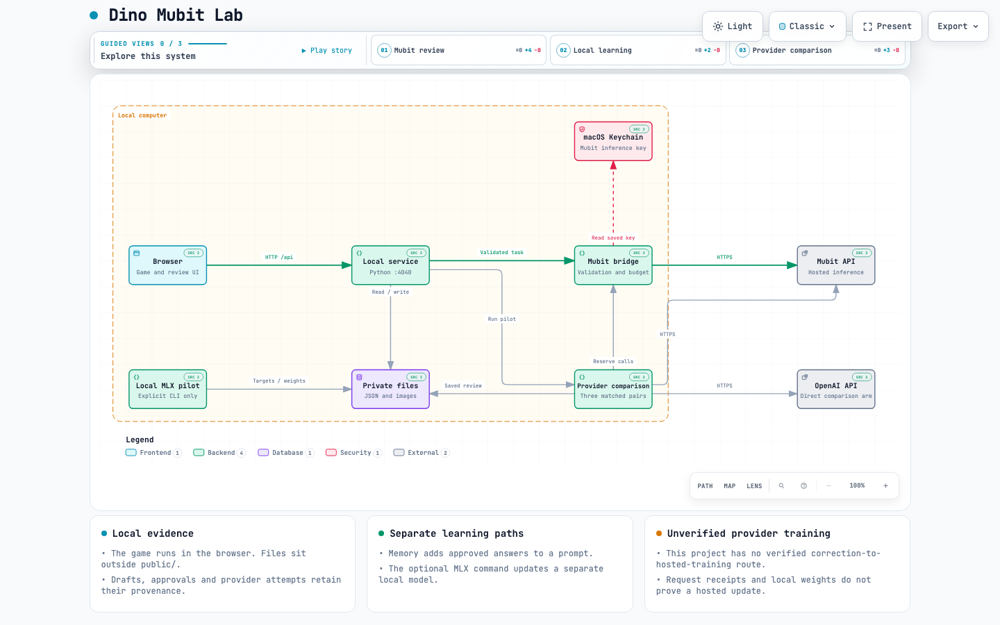
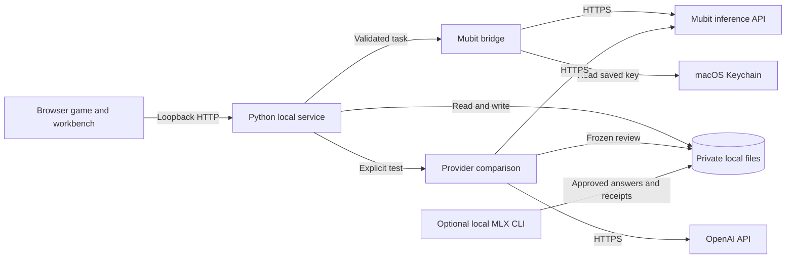
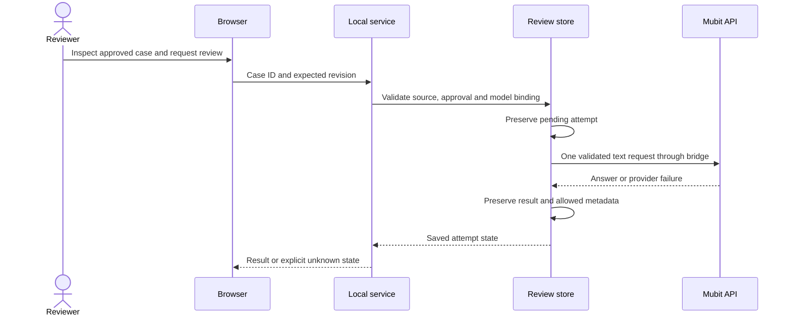

# System architecture: Dino Mubit Lab

## Overview

Dino Mubit Lab is a local web application for playing the dinosaur game and reviewing repeatable controller experiments. A browser runs the game and its controls. A Python process serves the interface, validates requests and keeps private evidence on the same computer. Optional requests use Mubit for decisions and reviews, or OpenAI directly for a bounded provider comparison.

Approved review answers can become examples in a later prompt or feed a separate local MLX LoRA pilot. These are different mechanisms. The application has no verified route from its correction exports to a Mubit training job or hosted model version.

The [interactive architecture map](docs/diagrams/dino-mubit-lab.html) contains source links, search, focus, guided views and directed route tracing. Download that HTML file and open it in a browser; GitHub's file view does not run its interactive controls. The map combines the [README](README.md) with this document and checks its source references against [commit `a4bd5ea`](https://github.com/MasteraSnackin/dino-mubit-lab/tree/a4bd5eae0a7f93a34c85572f23827bb65632e1ee). Its [editable source](docs/diagrams/dino-mubit-lab.architecture.json) describes the implemented relationships at that snapshot, including the current request-validation boundary. It does not represent observed live traffic. The validation rules are recorded in [Error handling](docs/ERROR-HANDLING.md).

## Key requirements

- Keep the game and local player usable without provider credentials.
- Run fixed-course experiments at normal speed and check baseline repeatability before testing a proposed change.
- Preserve source evidence, review revisions, approvals and failed or interrupted attempts.
- Keep API keys, private run records and model weights outside the served files and public repository.
- Validate model inputs and outputs, bound request sizes and prevent duplicate inference attempts.
- Separate confirmed references from edited corrections, and prompt memory from model-weight updates.
- Reserve evaluation courses so they cannot enter training exports.
- Present unknown provider outcomes and unavailable evidence as unknown.

## High-level architecture

Text overview (Mermaid)

The browser sends local requests to one Python service. That service keeps evidence in files and calls external inference APIs only through explicit actions. Local training starts through a command, while the web interface reads its saved status and receipts.

The diagram groups the storage modules into one file store for readability. There is no SQL database, message broker, hosted application server or serverless deployment in the current implementation.

## Component details

### Browser game and workbench

[public/index.html](public/index.html) loads the Chromium-derived game and the workbench modules. [public/index.js](public/index.js) runs the canvas game. [public/local-policy.js](public/local-policy.js) analyses canvas pixels and selects actions; [public/local-player.js](public/local-player.js) applies them and records a local run.

[public/experiment-runner.js](public/experiment-runner.js) controls fixed-course trials. The comparison, correction, compact review, memory and provider comparison panels make JSON requests to the Python service. Controller-ownership events prevent competing controls from driving the game at the same time.

Browser state includes the active controller, selected records, unsaved edits and pending actions. Saved evidence belongs to the server-side stores. The browser never receives the saved Mubit key. A separate OpenAI key can be entered for one provider comparison and is cleared from the input after submission.

### Local HTTP service

[serve.py](serve.py) uses `ThreadingHTTPServer` and `SimpleHTTPRequestHandler`. The normal launcher listens on `127.0.0.1:4040`, serves only `public/` and routes `/api/` requests to the relevant Python modules.

The handler checks the request host, requires a recognised local origin for mutations, limits request size and accepts JSON objects. It rejects directory listings. Its status and export routes read saved state; they do not start inference or local training.

The service loads the non-secret model selection from `mubit-settings.json`. A valid saved selection overrides `DINO_MUBIT_MODEL`; an absent file leaves the process environment available. This is a single-computer application, without account login or remote access management.

### Mubit bridge

[mubit_bridge.py](mubit_bridge.py) validates model configuration, game observations and review payloads. It uses fixed HTTPS endpoints, bounded responses and allowlisted result fields. It keeps a shared limit of 20 inference attempts per server session and coordinates calls through locks.

The bridge supports live game decisions, run reviews, bounded timing proposals and compact text reviews. A successful connection check establishes access to the selected model; it does not establish that an inference request succeeded or that Mubit trained a model.

Normal-speed Mubit play continues while a decision is pending, so a late reply can miss an obstacle. The UI also provides a separately labelled paused mode. The fixed-course suggestion experiment uses the local controller for movement and Mubit for a between-run proposal.

### Evidence and correction stores

[run_store.py](run_store.py) owns immutable local run records. [experiment_store.py](experiment_store.py) owns the baseline, repeat and candidate trial slots, along with the saved proposal and comparison. [learning_store.py](learning_store.py) imports completed evidence and manages correction drafts, approvals and the locked course split.

[review_task_store.py](review_task_store.py) builds the compact review task and preserves its model-bound attempt. [review_target_store.py](review_target_store.py) manages revisions of that exact saved answer. An unchanged approved answer is a `confirmed_reference`; an edited approved answer is a `corrected_answer`.

The stores use bounded JSON, validation, hashes, file locks and atomic writes. Private directories sit beside the source, outside `public/`, and are ignored by Git. The application reports unreadable evidence instead of silently treating it as an empty history.

### Memory-assisted review

[memory_review_store.py](memory_review_store.py) selects eligible approved compact answers and adds them to a later text request. It checks current source revisions and approvals before preserving the pending attempt and calling Mubit.

This route changes the prompt context. It does not change local or hosted model weights. Its receipt keeps the selected references and the returned answer so a reader can compare the same task with and without that context.

### Local model pilot

[local_adapter.py](local_adapter.py) prepares a frozen dataset from approved compact answers and a separately downloaded, revision-pinned base model. Explicit `prepare` and `run` commands create and execute one local attempt.

The runner uses a dedicated Python 3.12 environment and MLX on Apple silicon. Baseline generation, LoRA training and adapted generation run in separate child processes. Those children do not inherit service credentials, use local model files and disable model-hub network access and telemetry through their environment.

The receipt checks saved finite adapter tensors and non-zero parameter changes. It records training loss and a replay of training input. These checks can establish a local parameter update; they do not measure generalisation or prove a Mubit-hosted update. See [LOCAL-ADAPTER-README.txt](LOCAL-ADAPTER-README.txt).

### Provider comparison

[provider_comparison.py](provider_comparison.py) selects a completed compatible local compact review and freezes its request. It currently uses `gpt-6-luna` and an unchanged measured outcome. `DINO_COMPARISON_CASE_ID` can select a particular eligible case; otherwise the newest eligible completed review is selected.

The runner sends three alternating pairs through Mubit and OpenAI directly. Both routes receive the same model identifier, messages, response-format requirement, token cap and storage preference. Mubit calls share the bridge's allowance and configuration checks; the comparison sends its own HTTP requests to each fixed endpoint.

The OpenAI key stays in memory for that run. Receipts keep allowed response metadata, token usage, elapsed time and limited answer checks. Missing model provenance or usage remains unverified. This pilot does not infer billed cost, identical model weights or general provider quality. See [PROVIDER-COMPARISON-README.txt](PROVIDER-COMPARISON-README.txt).

### Credentials and configuration

[configure_mubit.py](configure_mubit.py) accepts hidden key input in Terminal and stores it in macOS Keychain. [key_store.py](key_store.py) provides the local browser's save-key route. The bridge can also read `MUBIT_API_KEY` from its process environment.

The model setting is a separate local JSON file. Keys are never part of a review, correction, model dataset or published source file. The provider comparison requires its own OpenAI credential because a Mubit key cannot authenticate to OpenAI directly.

## Data flow

### Record and compare a controller change

1. The browser runs baseline course A twice and course B once using fixed seeds and a fixed simulation step.
2. The server saves each bounded trial and checks that the repeated baseline agrees.
3. An explicit proposal request sends selected baseline frames and actions to Mubit.
4. The browser tests the accepted, bounded timing change on the same two courses.
5. The saved comparison retains the proposal, measurements, settings and consistency checks.
6. Importing a comparable result creates or reuses a correction case. Drafting and approval create revisions; they do not send data to a provider.

### Request a compact review

The pending attempt exists before the network call. If the response or final save is interrupted, the app preserves uncertainty and does not automatically send the same request again. The compact input contains measured outcomes, so this task reviews an already-tested change rather than predicting an unseen result.

### Reuse or train from an approved answer

The reviewer saves and separately approves a revision of the compact answer. Memory-assisted review reads eligible approved examples into a later prompt. Local training exports those approved examples into a frozen dataset and writes its own manifest, weights and receipt. These routes retain their own identities and do not overwrite the original model answer.

## Data model

| Entity | Main content | Relationship |
| --- | --- | --- |
| Run | Controller, timestamps, score, actions and frames | Evidence for a saved local run or experiment slot |
| Experiment | Course seeds, baseline slots, proposal and candidate slots | Source for a completed comparison |
| Correction case | Frozen comparison, source hash and revision history | Imports a specific full after-test task |
| Compact review attempt | Input hash, bound model, pending/result state and provider metadata | Reviews an approved case once |
| Reviewed answer target | Exact original answer, draft revisions, approval and review type | Supplies an approved compact reference or correction |
| Memory attempt | Frozen task, selected approved targets and returned answer | Compares prompt context for a saved input |
| Local adapter attempt | Model revision, dataset hash, training options, artifacts and receipt | Trains from approved compact targets locally |
| Provider comparison | Frozen request, three pair orders and per-response measurements | Compares Mubit and direct OpenAI for one input |

The reserved plan contains 40 training scenarios and 10 evaluation scenarios, each with two course seeds. These are collection targets, not accepted-example counts. Evaluation seeds are excluded from correction training exports and the recorded coaching path.

Private records are stored in `runs/`, `experiments/`, `learning/`, `review_tasks/`, `review_targets/`, `memory_reviews/`, `local_adapters/` and `provider_comparisons/`. Exports may contain source identifiers and game evidence, so they need review before sharing.

## Infrastructure and deployment

The supported deployment is a local macOS process and a browser on the same computer. Python's standard library is sufficient for the web service and provider calls. Optional training has its own dependency lock file, environment and model download.

The repository is public source hosting. It is not a hosted game deployment, and the full application cannot run on GitHub Pages. There are no separate production, staging or cloud environments in the repository. Automated tests use temporary directories and mocked provider responses. Documentation capture uses separate local records so it does not expose the user's private evidence.

The normal service has one fixed loopback port. If the launcher finds another matching Dino instance on that port, it opens the existing instance. It does not silently replace that process or move its data.

## Scalability and reliability

This is a bounded local prototype. The threaded HTTP server accepts local browser requests, while store locks protect concurrent writes and revision checks prevent a stale tab from approving a newer draft.

Storage and request limits keep the working set bounded. Examples include 100 local runs, 100 correction cases, up to 200 correction revision events per case and the shared 20-attempt inference allowance per server session. The implementation does not provide distributed locking, replication, automatic backups, failover or a multi-user workload guarantee.

Completed trial slots and saved inference attempts are retained. Atomic replacement protects individual file writes; manifests and hashes detect inconsistent evidence. A pending request after an interruption can mean the provider outcome is unknown, so retrying it automatically would risk duplicate inference. Recovery uses the saved state and the explicit actions supported by each workflow.

## Security and compliance

The server binds to loopback, checks the host and local request origin, rejects directory listings and bounds incoming payloads. External provider requests use fixed HTTPS endpoints with redirects disabled. Private stores use restrictive filesystem permissions and validate record names, content and hashes.

Mubit keys use macOS Keychain or the server's process environment. OpenAI comparison keys are held in memory for one test. Client-visible diagnostics avoid raw provider error bodies and exception text that could contain credentials.

These controls do not make the app a remote or multi-user service. There is no account authentication, signed reviewer identity or compliance certification. Local approval records an action in this app. The provider's storage and training behaviour is not independently verified, including when a request asks for recording to be disabled.

## Observability

The terminal shows local HTTP activity and service errors. Saved records provide the useful experiment trail: source and input hashes, timestamps, course consistency, model/request identifiers when available, outcome labels, token usage and latency. Local training adds package versions, artifact hashes, loss reports and parameter-change evidence.

There is no central logging service, metrics collector or distributed tracing backend. The UI distinguishes connection readiness, inference completion, local approval, memory use and verified local parameter change. Each status describes its own evidence rather than implying a complete learning system.

## Trade-offs and decisions

| Decision | Reason and cost |
| --- | --- |
| Local files instead of a database service | Keeps setup small and evidence inspectable; capacity and concurrency remain deliberately limited. |
| Browser canvas observations for the local player | Makes the controller's inputs observable; pixel heuristics can be fragile and require course checks. |
| One bounded setting change per coaching experiment | Makes a comparison easier to interpret; two courses still provide little evidence of general improvement. |
| Durable pending receipts before provider calls | Preserves uncertain outcomes and prevents blind repeats; some interrupted attempts cannot be resumed. |
| Separate correction schemas for proposal review and compact answers | Keeps training targets matched to the input actually seen by the model; the workflow needs explicit review steps. |
| Optional local MLX training | Allows a real local weight-update experiment; it requires Apple silicon, additional dependencies and model files. |
| Small paired provider pilot | Controls the request body and records usage; one repeated input cannot settle general quality, cost or latency. |

## Future improvements

- Collect multiple genuine corrected answers and evaluate a frozen model on independent reserved cases.
- Verify a supported Mubit correction-upload contract, image eligibility and served model-version identifiers before adding hosted training claims.
- Expand the provider comparison to independent tasks with an explicit evaluation protocol and verified price data when cost is measured.
- Add a documented backup and restore procedure for private evidence before considering larger datasets.
- Assess portability and multi-user requirements separately before adding remote hosting or other operating systems.

These are proposed follow-up work, not implemented capabilities.

## Architecture verification

The map checks source references against committed blobs, then validates layout and artifact identity. Its delivery receipt binds the editable JSON and generated HTML with SHA-256 hashes. Browser and perceptual checks are recorded separately in the diagram folder; they do not verify provider behaviour or prove runtime traffic.

The in-app browser checks confirmed search results, Mubit bridge focus and source links, the four-node Browser-to-Mubit route, and the two-stop local-learning chapter on a byte-identical loopback preview. The [interaction record](docs/diagrams/dino-mubit-lab.interactions.json) and [route screenshot](docs/diagrams/dino-mubit-lab.interactions.png) record that scope.

- [Map source](docs/diagrams/dino-mubit-lab.architecture.json)
- [Interactive HTML](docs/diagrams/dino-mubit-lab.html)
- [Validation report](docs/diagrams/dino-mubit-lab.validation.json)
- [Delivery receipt](docs/diagrams/dino-mubit-lab.delivery.json)
- [Automated browser evidence](docs/diagrams/dino-mubit-lab.visual-check.json)
- [Visual review and check scope](docs/diagrams/dino-mubit-lab.review.md)

Paths in public receipts are relative to the repository. That publication adjustment preserves the specification and artifact hashes.
