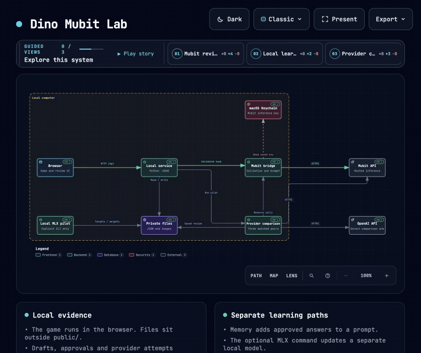

# Dino Mubit Lab

Test AI advice on a local dinosaur game. Run repeatable courses, compare a suggested change with the original player, then review the result. The app keeps the original answer, measurements and correction history together.

Use it as a small testbed for a recurring AI review workflow. You can start with local gameplay without an API key or internet connection.

[Demo video (1:50)](https://github.com/MasteraSnackin/dino-mubit-lab/releases/tag/demo-video-v2) · [Download MP4 (7.69 MB)](https://github.com/MasteraSnackin/dino-mubit-lab/releases/download/demo-video-v2/Dino-Mubit-Lab-recorded-demo.mp4) · [Live system map](https://masterasnackin.github.io/dino-mubit-lab/)

<a id="installation"></a>

## Quick start

1. Install Python 3 and Git on macOS. Windows is not currently supported. Node.js is only needed if you want to run the JavaScript tests.
2. Clone the project:

   ```sh
   git clone https://github.com/MasteraSnackin/dino-mubit-lab.git
   cd dino-mubit-lab
   ```

3. Start the local server:

   ```sh
   python3 serve.py --open
   ```

Open **http://127.0.0.1:4040/** if the browser does not open automatically. On macOS, you can also double-click `Start Dino.command`. Stop the server with **Ctrl+C** in its Terminal window.

Press **Space** or **Up** to start and jump, and **Down** to duck. The local player works without Mubit.


A fresh checkout starts without saved runs, review examples, comparison results or downloaded models. The app runs on your computer; the live system map is a separate static page. See [startup notes](docs/CONFIGURATION.md#startup-notes) if another copy is already using the local port.

## See it in action

**Local gameplay.** A rule-based player running at normal speed. No Mubit calls are made in this recording.


**System map.** A recorded tour of the review, local learning and provider comparison paths. Select the GIF to explore the live map yourself.

[](https://masterasnackin.github.io/dino-mubit-lab/)

[Recording details and source records](docs/media/README.md).

## Choose what to try

| I want to… | What I need | Where to start |
| --- | --- | --- |
| Play the game or watch the local player | The local app; no API key | [Quick start](#quick-start) |
| Test Mubit advice and review its answer | A Mubit project inference key; provider calls may use credit | [Configure Mubit](docs/CONFIGURATION.md), then follow the workflow below |
| Train a separate local model from approved answers | Apple silicon, Python 3.12 and the optional model and training setup | [Local adapter guide](LOCAL-ADAPTER-README.txt) |

<a id="usage"></a>
<a id="play-and-test-a-suggestion"></a>

## Review workflow

1. Run the baseline courses to record how the original player performs.
2. Ask Mubit for one change, then test it on the same courses.
3. Inspect the measurements, save your review and approve that revision.
4. Request a short text review of the result, then check, correct if needed, and approve the saved answer.
5. Reuse approved answers as examples in a later prompt, or prepare a separate local training run.

The [full workflow](docs/REFERENCE.md#usage) explains the controls, approvals and evidence each step keeps. Mubit can also choose moves directly; [gameplay modes](docs/REFERENCE.md#features) explain normal-speed and paused play.

## Reading the results

- A saved correction records a review. It does not update a model by itself.
- Prompt memory adds approved examples to a request. Local LoRA training adapts a separate local model and keeps its own evidence.
- Training or a new model version hosted by Mubit remains unverified.
- Two game courses and six provider responses to one input are small experiments. They do not establish general improvements in play, quality, speed or cost.

Local keys, run records and model weights stay out of the public repository. [Configuration and privacy](docs/CONFIGURATION.md) explains what is stored locally and what explicit provider actions send.

<a id="architecture-overview"></a>
<a id="configuration"></a>
<a id="screenshots-and-demo"></a>

## Guides

| For… | Read… |
| --- | --- |
| Keys, settings and startup issues | [Configuration](docs/CONFIGURATION.md) |
| Fixed-course experiments | [Suggestion testing](COMPARISON-README.txt) |
| Reviews, corrections and approvals | [Correction workflow](TRACK1-README.txt) and [compact answer reviews](REVIEW-TASK-README.txt) |
| Local model training | [Local adapter guide](LOCAL-ADAPTER-README.txt) |
| Mubit versus OpenAI | [Provider comparison](PROVIDER-COMPARISON-README.txt); requires a separate OpenAI key and may use credit on both routes |
| Features, commands, API, tests and roadmap | [Technical reference](docs/REFERENCE.md) |
| Components and data flow | [Architecture](ARCHITECTURE.md) and [live system map](https://masterasnackin.github.io/dino-mubit-lab/) |
| Video, screenshots and their source records | [Demo and captures](docs/media/README.md) |

## Contributing and support

Read the [contribution guide](docs/CONTRIBUTING.md) for development and testing. Report problems through [GitHub issues](https://github.com/MasteraSnackin/dino-mubit-lab/issues) or propose changes through [pull requests](https://github.com/MasteraSnackin/dino-mubit-lab/pulls). Include what you expected, what happened and steps to reproduce it, with credentials and private records removed.

Maintained under the [MasteraSnackin account](https://github.com/MasteraSnackin).

## Licence

The game is derived from [wayou/t-rex-runner](https://github.com/wayou/t-rex-runner/tree/5455bfa408ec6b707c7300ff194b7390733a766d), which extracts the Chromium dinosaur game. Original Chromium copyright notices and the upstream [BSD 3-Clause licence](LICENSE) are retained, including the copy in [`public/LICENSE`](public/LICENSE).

This project adds the local server, players, Mubit integration, review workflow and experiment tooling. It is an independent prototype and is not endorsed by Google, Chromium or Mubit.
