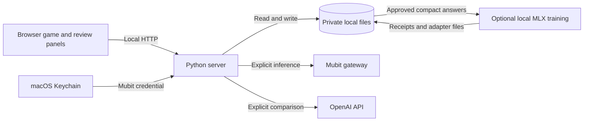
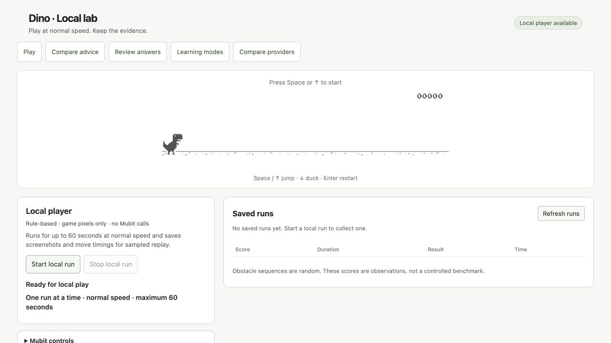
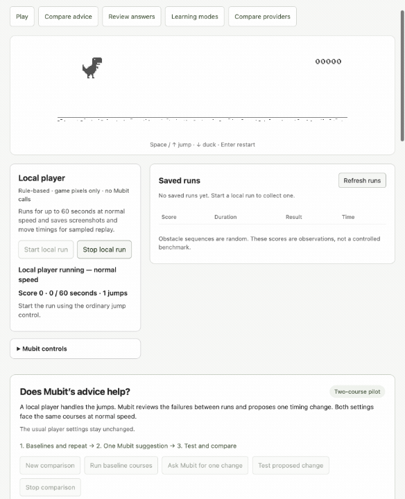
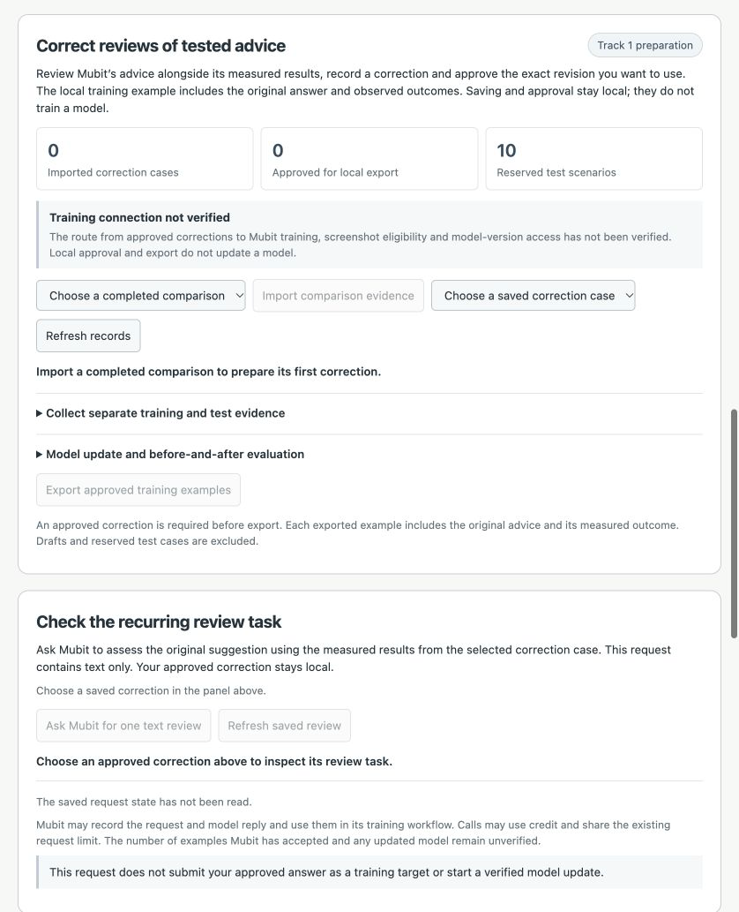

# Dino Mubit Lab

A local dinosaur game for testing AI suggestions, reviewing answers and keeping evidence of model experiments.

## Description

Dino Mubit Lab is for people building a recurring AI review workflow. Play the game, test a Mubit suggestion on repeatable courses, compare it with the baseline, then save and approve a review of the result. The app keeps the original answer, measurements and correction history together.

Mubit inference, approved examples reused in a prompt, and optional local LoRA training have separate records. A saved correction is not a model update, and this project has not verified training or a new model version hosted by Mubit.

## Contents

- [Description](#description)
- [Features](#features)
- [Tech stack](#tech-stack)
- [Architecture overview](#architecture-overview)
- [Installation](#installation)
- [Usage](#usage)
- [Configuration](#configuration)
- [Screenshots and demo](#screenshots-and-demo)
- [API and CLI reference](#api-and-cli-reference)
- [Tests](#tests)
- [Roadmap](#roadmap)
- [Contributing](#contributing)
- [Licence](#licence)
- [Contact and support](#contact-and-support)

## Features

- Play manually or use a local rule-based player without an API key or internet connection.
- Let Mubit choose moves from screenshots and game state. Normal-speed mode keeps running while replies arrive; a separately labelled paused mode is available.
- Repeat baseline courses, check their consistency and test one bounded timing change on two fixed courses at normal speed.
- Preserve original answers, measured outcomes, draft revisions and approvals. An edited answer is recorded separately from an unchanged confirmed reference.
- Add eligible approved compact answers to a later Mubit prompt, or train a separate local model with the optional MLX LoRA pilot.
- Compare three Mubit calls with three direct OpenAI calls using the same compact request, recording token counts, response times and limited answer checks.

Late model replies can miss obstacles. Two courses do not establish a generally better player, and six responses to one input do not establish a general provider advantage. Memory examples change prompt context; local LoRA changes a separate local model. Neither proves that Mubit changed its hosted model weights.

## Tech stack

| Part | Implementation |
| --- | --- |
| Game and interface | HTML, CSS, browser JavaScript and Canvas, based on the Chromium dinosaur game |
| Local server | Python standard library with `ThreadingHTTPServer` |
| Records | Local JSON files, file locks, revision checks and hashes |
| Mubit integration | Server-side HTTPS requests with a per-session inference limit |
| Direct provider comparison | OpenAI API, with a separate key held in memory for one test |
| Optional local training | MLX LoRA on Apple silicon, using a separate Python 3.12 environment |
| Tests | Python `unittest` and Node.js's built-in test runner |

macOS is the tested platform. The current POSIX file-locking implementation does not support Windows. Node.js is needed only for the JavaScript tests; ordinary gameplay, Mubit requests and review storage require no additional Python packages.

## Architecture overview



The browser runs the game and sends local requests to the Python server. The server owns private records and makes explicit provider requests; its public web directory contains only the interface and assets. Local training runs separately from Mubit inference and writes its own evidence.

Read [ARCHITECTURE.md](ARCHITECTURE.md) or download and open the [interactive system map](docs/diagrams/dino-mubit-lab.html). The [editable map source](docs/diagrams/dino-mubit-lab.architecture.json) and [delivery receipt](docs/diagrams/dino-mubit-lab.delivery.json) sit beside it. GitHub displays the HTML source; open the downloaded file in a browser to use the map.

## Installation

1. Install a current Python 3 release on macOS. Git is needed to clone the repository. Install Node.js if you want to run the JavaScript tests.
2. Clone the project:

   ```sh
   git clone https://github.com/MasteraSnackin/dino-mubit-lab.git
   cd dino-mubit-lab
   ```

3. Start the local server:

   ```sh
   python3 serve.py --open
   ```

Open **http://127.0.0.1:4040/** if the browser does not open automatically. On macOS, you can also double-click `Start Dino.command`. Stop the server with **Ctrl+C** in its Terminal window.

A fresh checkout contains no saved runs, review examples, comparison results or downloaded models. If another copy of this app already owns port 4040, the launcher opens that running copy; stop it first to run this checkout.

The server listens on this computer only and serves `public/`. The repository is public source code for a local app. The complete app cannot run on GitHub Pages because the API and private storage need the Python server.

## Usage

### Play and test a suggestion

Press **Space** or **Up** to start and jump, and **Down** to duck. The local player works without Mubit.

For the recurring review workflow:

1. Create a comparison and run its baseline courses. Keep the page visible while the trials run.
2. Check the Mubit connection, ask for one change and test the proposal on the same courses.
3. Import the completed comparison into the correction workflow. Inspect the evidence, save a review and approve that exact revision.
4. Request one compact text review of the measured result. Review the saved answer, save any correction and approve it.
5. Use the approved compact answer as memory for a later request, or prepare the optional local training pilot. Keep the receipts when comparing results.

The scenario plan separates training courses from reserved evaluation courses. Planned counts are not collected-example counts. Failed and interrupted attempts remain recorded, and refreshing the page does not automatically repeat a saved provider request.

### Compare Mubit with OpenAI directly

Complete an eligible local compact review, then follow the [six-request comparison guide](PROVIDER-COMPARISON-README.txt). The panel previews the identical request before sending it. The pilot currently uses `gpt-6-luna` and a completed review whose measured outcome is unchanged on both courses.

The test needs a separate OpenAI API key. It uses that key in memory and does not save it. Starting the test may consume credit on both routes. Receipts record tokens and measured response times; the app does not infer billed costs or prove that both routes use identical model weights.

### Train a local adapter

Use a dedicated Python 3.12 environment on Apple silicon and the pinned [training dependencies](requirements-local-training.lock.txt). Download the optional base model separately, pin it to a full revision and keep it outside the repository or in the ignored `local_models/` directory. Follow the [local adapter guide](LOCAL-ADAPTER-README.txt) for preparation, the explicit training command and evidence export.

Opening the app or reading training status does not download a model or start training. The pilot checks saved parameter changes, but replaying its training examples is not independent evaluation. Model weights and local training records are excluded from Git.

### Workflow guides

- [Fixed-course suggestion testing](COMPARISON-README.txt)
- [Correction workflow and reserved scenarios](TRACK1-README.txt)
- [Compact review task and answer approvals](REVIEW-TASK-README.txt)
- [Local LoRA preparation and evidence](LOCAL-ADAPTER-README.txt)
- [Mubit versus direct OpenAI comparison](PROVIDER-COMPARISON-README.txt)

### Use a temporary demo

For a separate copy of the interface with temporary records, run:

```sh
python3 scripts/demo_server.py --port 4041
```

Open **http://127.0.0.1:4041/**. This loopback server disables provider and Keychain access, starts without your real saved results and removes its temporary records when it exits normally. Use **Ctrl+C** to stop it. It is suitable for local gameplay and interface captures; it cannot demonstrate a live Mubit response.

## Configuration

Create a Mubit project inference key and obtain an available model ID from your account. Run this in a normal Terminal window:

```sh
python3 configure_mubit.py
```

Setup asks for the model ID, then accepts the key with hidden input. It stores the key in macOS Keychain and the non-secret model selection in the ignored `mubit-settings.json`. The app also has a **Save key locally** control. After setup, choose **Check connection** in the game.

| Setting | Purpose |
| --- | --- |
| `MUBIT_API_KEY` | Supplies a Mubit key through the process environment. Otherwise the server checks macOS Keychain. |
| `DINO_MUBIT_MODEL` | Supplies the selected model ID. A saved model setting takes precedence. |
| `mubit-settings.json` | Stores the local, non-secret model selection. Do not commit it. |
| `DINO_COMPARISON_CASE_ID` | Optionally selects a particular locally saved case for the provider comparison. Otherwise the newest eligible completed review is selected. |

`.env` files are ignored by Git but are not loaded automatically. Do not put credentials in source files or shell commands saved to history.

Saving a key and checking connectivity do not start inference or gameplay. Play and review controls send the displayed evidence through Mubit and may use credit. The bridge permits up to 20 inference attempts per server session. A verified connection is distinct from a successful model response.

Runtime runs, screenshots, experiments, corrections, provider receipts and training output stay in private directories outside `public/`. These directories and local settings are ignored by Git. Export files can contain review text and source identifiers, so inspect them before sharing. Real keys, personal run records, downloaded models and historical private receipts are excluded from this repository.

Mubit receives evidence through the explicit play and review actions described in the interface. The provider may retain recorded calls under its own service arrangements. This app does not establish whether those calls became training data or changed a hosted model.

## Screenshots and demo

The following captures show the local application using separate demonstration records. The [capture guide](docs/media/README.md) includes mobile, saved-run and recovery views; the [capture record](docs/media/capture-record.json) describes the source, actions and verification. Local gameplay in the GIF does not demonstrate Mubit inference or model training.







There is no hosted gameplay demo. Run the local server to use the application.

## API and CLI reference

The browser uses a loopback API. POST requests require a recognised local host and origin, JSON input and the route's bounded request size. Use the interface for provider calls and approval actions.

| Method and path | Purpose |
| --- | --- |
| `GET /__dino_health` | Identify this local server. |
| `GET /api/runs` | List saved runs. |
| `GET /api/experiments` | List saved course comparisons. |
| `GET /api/learning/cases` | List correction cases. |
| `GET /api/mubit/status` | Read connection state without starting inference. |
| `GET /api/provider-comparison` | Read the provider comparison preview or saved result. |
| `GET /api/local-adapter/status` | Read local training evidence without starting training. |

For example, with the server running:

```sh
curl http://127.0.0.1:4040/__dino_health
curl http://127.0.0.1:4040/api/provider-comparison
```

These requests do not start a provider comparison. The full route implementation is in [serve.py](serve.py).

| Command | Purpose |
| --- | --- |
| `python3 serve.py --open` | Start or open the local app. |
| `python3 configure_mubit.py` | Save a model choice and enter a Mubit key privately. |
| `python3 configure_mubit.py --key-only` | Save a key without changing the model selection. |
| `python3 local_adapter.py status` | Read the optional local adapter's saved state. |
| `python3 local_adapter.py export` | Export the optional local adapter's evidence. |

Training preparation and execution are separate commands documented in [LOCAL-ADAPTER-README.txt](LOCAL-ADAPTER-README.txt).

## Tests

Run these from the repository directory:

```sh
python3 -m unittest discover -p 'test_*.py'
node --test public/*.test.cjs
```

Tests use temporary stores, synthetic game data and mocked provider responses. They cover request validation, storage integrity, revision conflicts, course consistency, controller behaviour, recovery and provider comparisons. They do not need a live provider key or establish model training by Mubit.

The delivery checks on 25 October 2026 passed 288 Python tests, 83 JavaScript tests and five isolated recovery branches.

The [audit](docs/AUDIT.md), [design review](docs/DESIGN.md), [builder report](docs/BUILDER.md), [debugging report](docs/DEBUG.md), [error-handling review](docs/ERROR-HANDLING.md) and [performance review](docs/PERFORMANCE.md) record the scope and results of the latest checks. The [attachment coverage record](docs/ATTACHMENT-COVERAGE.md) maps the supplied briefs to their deliverables.

## Roadmap

- Verify a supported Mubit correction-to-training contract and obtain evidence of any resulting hosted model version.
- Collect multiple genuine corrections and evaluate improvements on independent cases through an appropriate evaluation route.
- Broaden provider comparisons beyond repeated responses to one input before making quality, speed or cost claims.

The [research note](docs/RESEARCH.md) separates practical improvements from questions that need further experiments.

## Contributing

Read [the contribution guide](docs/CONTRIBUTING.md), make a focused change and run the relevant tests. Report reproducible problems through [GitHub issues](https://github.com/MasteraSnackin/dino-mubit-lab/issues); propose changes through [pull requests](https://github.com/MasteraSnackin/dino-mubit-lab/pulls). Exclude credentials, personal records and model weights from reports and commits.

## Licence

The game is derived from [wayou/t-rex-runner](https://github.com/wayou/t-rex-runner/tree/5455bfa408ec6b707c7300ff194b7390733a766d), which extracts the Chromium dinosaur game. Original Chromium copyright notices and the upstream [BSD 3-Clause licence](LICENSE) are retained, including the copy in [`public/LICENSE`](public/LICENSE).

This project adds the local server, players, Mubit integration, review workflow and experiment tooling. It is an independent prototype and is not endorsed by Google, Chromium or Mubit.

## Contact and support

Use [this repository's issues](https://github.com/MasteraSnackin/dino-mubit-lab/issues) for questions, reproducible problems and suggestions. The repository is maintained under the [MasteraSnackin account](https://github.com/MasteraSnackin). Include the affected workflow, expected behaviour, actual behaviour and steps to reproduce, with private information removed.
