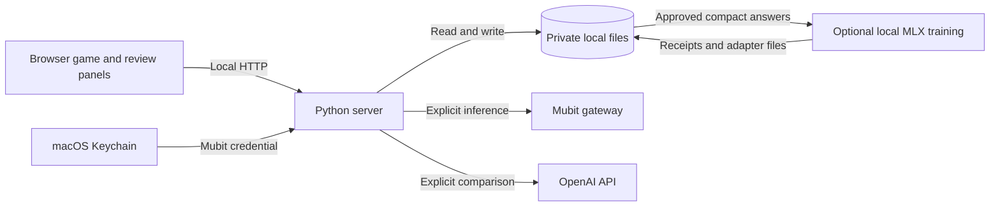

# Technical reference

[Back to the README](../README.md) · [Configuration and local setup](CONFIGURATION.md)

## Contents

- [Features](#features)
- [Tech stack](#tech-stack)
- [Architecture overview](#architecture-overview)
- [Usage](#usage)
- [API and CLI reference](#api-and-cli-reference)
- [Tests](#tests)
- [Roadmap](#roadmap)

## Features

- Play manually or use a local rule-based player without an API key or internet connection.
- Let Mubit choose moves from screenshots and game state. Normal-speed mode keeps running while replies arrive; a separately labelled paused mode is available.
- Repeat baseline courses, check their consistency and test one bounded timing change on two fixed courses at normal speed.
- Preserve original answers, measured outcomes, draft revisions and approvals. An edited answer is recorded separately from an unchanged confirmed reference.
- Add eligible approved compact answers to a later Mubit prompt, or train a separate local model with the optional MLX LoRA pilot.
- Compare three Mubit calls with three direct OpenAI calls using the same compact request, recording token counts, response times and limited answer checks.

Late model replies can miss obstacles. Two courses do not establish a generally better player, and six responses to one input do not establish a general provider advantage. Memory examples change prompt context; local LoRA changes a separate local model. Neither proves that Mubit changed its hosted model weights.

## Tech stack

| Part | Implementation |
| --- | --- |
| Game and interface | HTML, CSS, browser JavaScript and Canvas, based on the Chromium dinosaur game |
| Local server | Python standard library with `ThreadingHTTPServer` |
| Records | Local JSON files, file locks, revision checks and hashes |
| Mubit integration | Server-side HTTPS requests with a per-session inference limit |
| Direct provider comparison | OpenAI API, with a separate key held in memory for one test |
| Optional local training | MLX LoRA on Apple silicon, using a separate Python 3.12 environment |
| Tests | Python `unittest` and Node.js's built-in test runner |

macOS is the tested platform. The current POSIX file-locking implementation does not support Windows. Node.js is needed only for the JavaScript tests; ordinary gameplay, Mubit requests and review storage require no additional Python packages.

## Architecture overview


<details>
<summary>Text overview (Mermaid)</summary>



</details>

The browser runs the game and sends local requests to the Python server. The server owns private records and makes explicit provider requests; its public web directory contains only the interface and assets. Local training runs separately from Mubit inference and writes its own evidence.

The Archify map combines the [README](../README.md) with [ARCHITECTURE.md](../ARCHITECTURE.md), checked against code at [commit `a4bd5ea`](https://github.com/MasteraSnackin/dino-mubit-lab/tree/a4bd5eae0a7f93a34c85572f23827bb65632e1ee). Open the [live interactive system map](https://masterasnackin.github.io/dino-mubit-lab/) to search components, trace routes and switch between the three guided views. It runs directly in your browser on GitHub Pages and needs no API key or local server.

The [standalone HTML file](diagrams/dino-mubit-lab.html), [editable map source](diagrams/dino-mubit-lab.architecture.json) and [delivery receipt](diagrams/dino-mubit-lab.delivery.json) remain available in the repository. GitHub's file viewer displays the HTML source; download that file to open it offline. See the [Pages publishing note](diagrams/PUBLISHING.md) for the hosted copy's source and update process.

## Usage

### Play and test a suggestion

For the recurring review workflow:

1. Create a comparison and run its baseline courses. Keep the page visible while the trials run.
2. Check the Mubit connection, ask for one change and test the proposal on the same courses.
3. Import the completed comparison into the correction workflow. Inspect the evidence, save a review and approve that exact revision.
4. Request one compact text review of the measured result. Review the saved answer, save any correction and approve it.
5. Use the approved compact answer as memory for a later request, or prepare the optional local training pilot. Keep the receipts when comparing results.

The scenario plan separates training courses from reserved evaluation courses. Planned counts are not collected-example counts. Failed and interrupted attempts remain recorded, and refreshing the page does not automatically repeat a saved provider request.

### Compare Mubit with OpenAI directly

Complete an eligible local compact review, then follow the [six-request comparison guide](../PROVIDER-COMPARISON-README.txt). The panel previews the identical request before sending it. The pilot currently uses `gpt-6-luna` and a completed review whose measured outcome is unchanged on both courses.

The test needs a separate OpenAI API key. It uses that key in memory and does not save it. Starting the test may consume credit on both routes. Receipts record tokens and measured response times; the app does not infer billed costs or prove that both routes use identical model weights.

### Train a local adapter

Use a dedicated Python 3.12 environment on Apple silicon and the pinned [training dependencies](../requirements-local-training.lock.txt). Download the optional base model separately, pin it to a full revision and keep it outside the repository or in the ignored `local_models/` directory. Follow the [local adapter guide](../LOCAL-ADAPTER-README.txt) for preparation, the explicit training command and evidence export.

Opening the app or reading training status does not download a model or start training. The pilot checks saved parameter changes, but replaying its training examples is not independent evaluation. Model weights and local training records are excluded from Git.

### Workflow guides

- [Fixed-course suggestion testing](../COMPARISON-README.txt)
- [Correction workflow and reserved scenarios](../TRACK1-README.txt)
- [Compact review task and answer approvals](../REVIEW-TASK-README.txt)
- [Local LoRA preparation and evidence](../LOCAL-ADAPTER-README.txt)
- [Mubit versus direct OpenAI comparison](../PROVIDER-COMPARISON-README.txt)

## API and CLI reference

The browser uses a loopback API. POST requests require a recognised local host and origin, JSON input and the route's bounded request size. Use the interface for provider calls and approval actions.

| Method and path | Purpose |
| --- | --- |
| `GET /__dino_health` | Identify this local server. |
| `GET /api/runs` | List saved runs. |
| `GET /api/experiments` | List saved course comparisons. |
| `GET /api/learning/cases` | List correction cases. |
| `GET /api/mubit/status` | Read connection state without starting inference. |
| `GET /api/provider-comparison` | Read the provider comparison preview or saved result. |
| `GET /api/local-adapter/status` | Read local training evidence without starting training. |

For example, with the server running:

```sh
curl http://127.0.0.1:4040/__dino_health
curl http://127.0.0.1:4040/api/provider-comparison
```

These requests do not start a provider comparison. The full route implementation is in [serve.py](../serve.py).

| Command | Purpose |
| --- | --- |
| `python3 serve.py --open` | Start or open the local app. |
| `python3 configure_mubit.py` | Save a model choice and enter a Mubit key privately. |
| `python3 configure_mubit.py --key-only` | Save a key without changing the model selection. |
| `python3 local_adapter.py status` | Read the optional local adapter's saved state. |
| `python3 local_adapter.py export` | Export the optional local adapter's evidence. |

Training preparation and execution are separate commands documented in [LOCAL-ADAPTER-README.txt](../LOCAL-ADAPTER-README.txt).

## Tests

Run these from the repository directory:

```sh
python3 -m unittest discover -p 'test_*.py'
node --test public/*.test.cjs
```

Tests use temporary stores, synthetic game data and mocked provider responses. They cover request validation, storage integrity, revision conflicts, course consistency, controller behaviour, recovery and provider comparisons. They do not need a live provider key or establish model training by Mubit.

The delivery checks on 25 October 2026 passed 288 Python tests, 83 JavaScript tests and five isolated recovery branches.

The [audit](AUDIT.md), [design review](DESIGN.md), [builder report](BUILDER.md), [debugging report](DEBUG.md), [error-handling review](ERROR-HANDLING.md) and [performance review](PERFORMANCE.md) record the scope and results of the latest checks. The [attachment coverage record](ATTACHMENT-COVERAGE.md) maps the supplied briefs to their deliverables.

## Roadmap

- Verify a supported Mubit correction-to-training contract and obtain evidence of any resulting hosted model version.
- Collect multiple genuine corrections and evaluate improvements on independent cases through an appropriate evaluation route.
- Broaden provider comparisons beyond repeated responses to one input before making quality, speed or cost claims.

The [research note](RESEARCH.md) separates practical improvements from questions that need further experiments.
